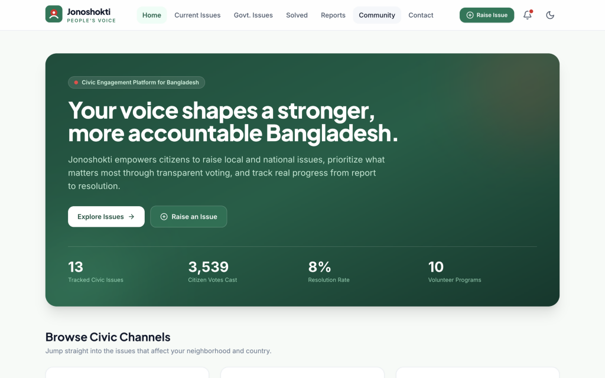
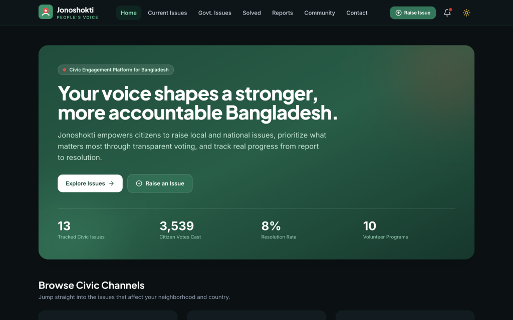
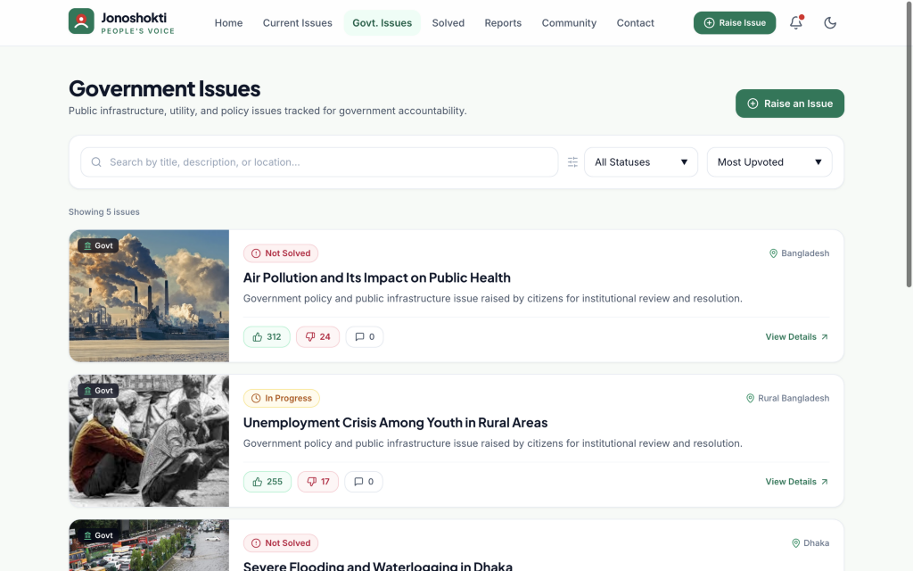
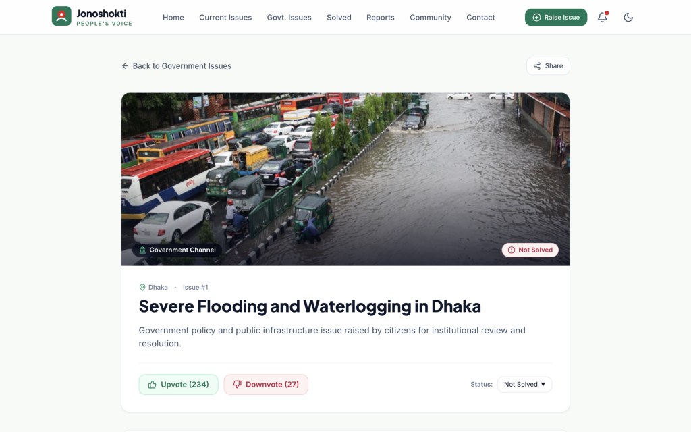
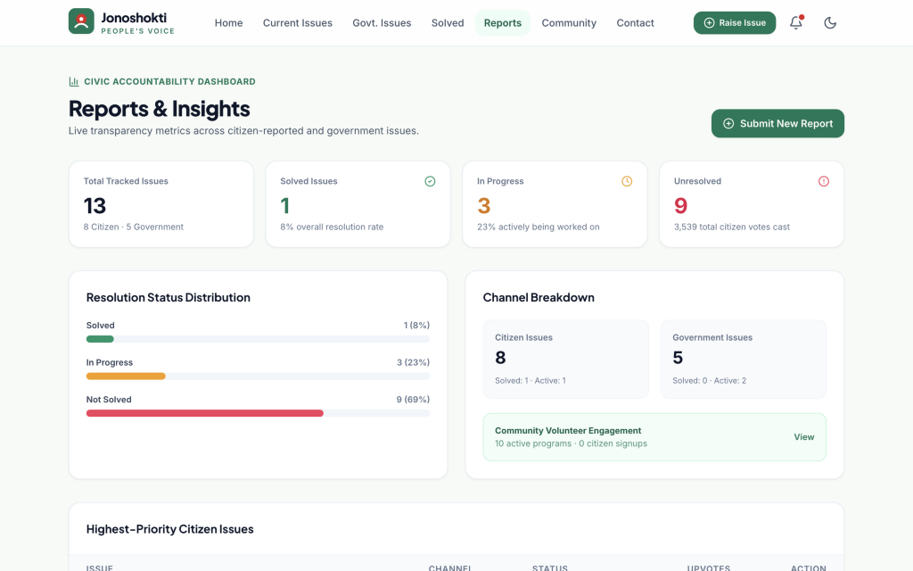
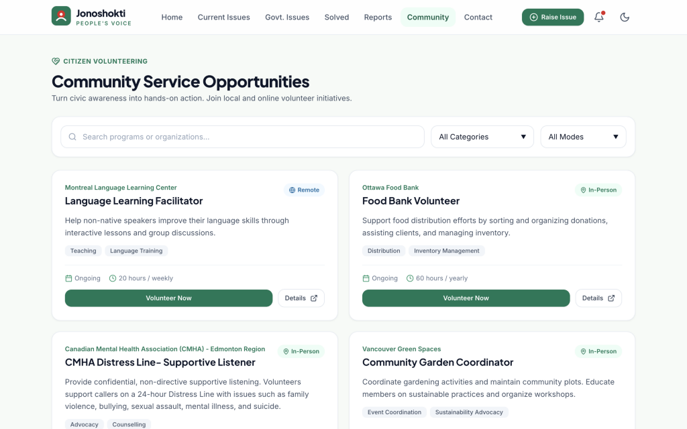

<div align="center">


# Jonoshokti

**People's Civic Engagement Platform for Bangladesh**

Empowering citizens to raise local and national issues, prioritize them through transparent voting, track government accountability, and join grassroots community service initiatives.

[](https://jonoshokti.vercel.app)
[](https://react.dev)
[](https://vite.dev)
[](https://tailwindcss.com)
[](https://expressjs.com)
[](https://www.mongodb.com)

</div>

---

## Screenshots

### Homepage — Light & Dark Mode

| Light Mode | Dark Mode |
| :---: | :---: |
|  |  |

### Platform Views

| Government & Citizen Issues | Issue Details & Discussion |
| :---: | :---: |
|  |  |

| Civic Reports & Insights | Community Service Opportunities |
| :---: | :---: |
|  |  |

---

## Features

- **Live Civic Dashboard (`/`)**: Real-time metrics pulled from MongoDB — tracked issues, citizen votes cast, overall resolution rate, volunteer programs, and top prioritized issues.
- **Current Citizen Issues (`/current-issues`) & Government Issues (`/govt-issues`)**:
  - Instant search across titles, descriptions, and locations.
  - Filter by status (`Not Solved`, `In Progress`, `Solved`) and sort by `Most Upvoted`, `Least Upvoted`, `Most Discussed`, or `Newest`.
  - Toggleable, race-condition-free atomic upvoting/downvoting persisted in MongoDB.
  - **Raise an Issue** modal to publish new citizen or government issues directly to the platform.
- **Solved Issues (`/solved-issues`)**: Dedicated channel highlighting resolved issues across both citizen and government collections.
- **Issue Details & Citizen Discussion (`/issues/:source/:id`)**: Full issue view with status updates, voting, copy-link sharing, and live citizen comments persisted to MongoDB.
- **Reports & Insights (`/reports`)**: Live accountability dashboard featuring KPI summary cards, resolution status distribution bars, channel breakdown, and a highest-priority issues table.
- **Community Service (`/community-service`)**: Browse volunteer opportunities with search, category filters, remote/in-person filtering, and an integrated volunteer registration modal.
- **Contact Us (`/contact-us`)**: Validated contact form saving inquiries directly to MongoDB.
- **Coherent Civic Emerald Design System**: Unified light & dark themes, responsive navigation, custom SVG brand emblem, and a live trending notifications popover.

---

## Project Structure

```text
Jonoshokti/
├── api/
│   └── index.js                  # Vercel Serverless Function entry (exports Express app)
├── backend/
│   ├── app.js                    # Express configuration & DB connection middleware
│   ├── db.js                     # Serverless-friendly cached Mongoose connection
│   ├── index.js                  # Local development server entry
│   ├── .env.example              # Environment variable template
│   ├── models/
│   │   └── schemas.js            # Mongoose models (GovtIssues, Issue, CommunityService, Contact, VolunteerRegistration)
│   └── routes/
│       └── api.js                # Consolidated REST API routes (/api/*)
├── docs/
│   └── screenshots/              # UI screenshots used in documentation
├── frontend/
│   ├── index.html                # Vite HTML entry + zero-flash dark mode script
│   ├── vite.config.js            # Vite config with /api dev proxy
│   ├── tailwind.config.js        # Tailwind theme configuration
│   ├── public/
│   │   └── favicon.svg           # Jonoshokti SVG emblem
│   └── src/
│       ├── App.jsx               # Route definitions
│       ├── lib/api.js            # Axios instance & vote state helpers
│       ├── context/              # ThemeContext (light/dark persistence)
│       ├── components/           # Layout, Logo, IssueCard, StatusBadge, ReportIssueModal
│       └── pages/                # HomePage, IssuesPage, IssueDetailsPage, ReportsPage, CommunityServicePage, ContactPage
├── package.json                  # Root scripts & backend dependencies
└── vercel.json                   # Vercel build & SPA/API rewrite configuration
```

---

## API Endpoints

| Method | Endpoint | Description |
| :--- | :--- | :--- |
| `GET` | `/api/health` | API health check |
| `GET` | `/api/stats` | Consolidated platform KPIs, channel counts, top issues, and recent activity |
| `GET` | `/api/issues` | List issues (`?category=current\|govt\|solved\|all&status=...&search=...&sort=...`) |
| `POST` | `/api/issues` | Create a new citizen or government issue |
| `GET` | `/api/issues/:source/:id` | Get full details and comments for a specific issue |
| `PATCH` | `/api/issues/:source/:id/vote` | Atomically update upvotes/downvotes |
| `PATCH` | `/api/issues/:source/:id/status` | Update issue status (`Not Solved`, `In Progress`, `Solved`) |
| `POST` | `/api/issues/:source/:id/comments` | Post a new comment on an issue |
| `GET` | `/api/community-service` | List volunteer programs with search, category, and mode filters |
| `POST` | `/api/community-service/:id/volunteer` | Submit a volunteer registration |
| `POST` | `/api/contact` | Submit a contact message |

---

## Getting Started

### Prerequisites

- Node.js 18+
- A MongoDB Atlas (or local MongoDB) connection string

### Local Development

1. **Clone the repository**
   ```bash
   git clone https://github.com/muuushfique/Jonoshokti.git
   cd Jonoshokti
   ```

2. **Configure environment variables**
   ```bash
   cp backend/.env.example backend/.env
   ```
   Update `backend/.env` with your MongoDB URI:
   ```env
   DB_URI=mongodb+srv://<username>:<password>@<cluster>.mongodb.net/JS_db?retryWrites=true&w=majority
   PORT=1241
   ```

3. **Install dependencies**
   ```bash
   npm install
   npm --prefix frontend install
   ```

4. **Run backend and frontend in separate terminals**
   ```bash
   # Terminal 1 — Express API (http://localhost:1241)
   npm run dev:backend

   # Terminal 2 — Vite dev server (http://localhost:5173)
   npm run dev:frontend
   ```

### Production Build & Vercel Deployment

- The project is configured for zero-config full-stack deployment on **Vercel** via `vercel.json`:
  - `frontend/` builds into `frontend/dist`
  - `/api/*` routes automatically to the Express serverless function in `api/index.js`
- Add `DB_URI` as an environment variable in your Vercel project settings and deploy:
  ```bash
  npx vercel --prod
  ```
